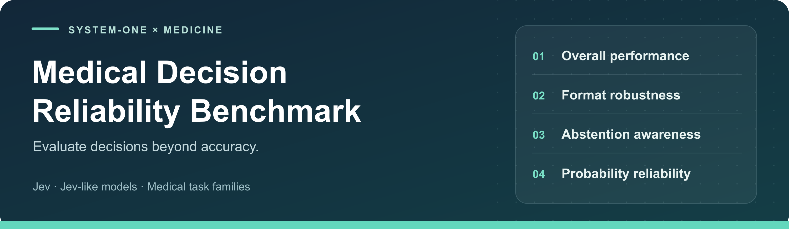
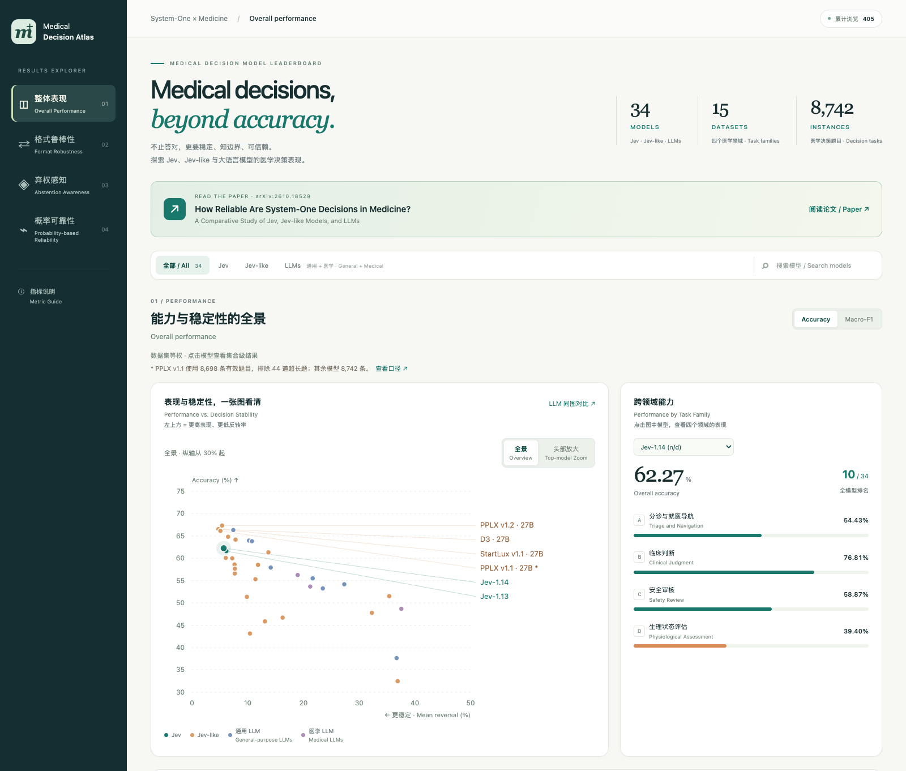
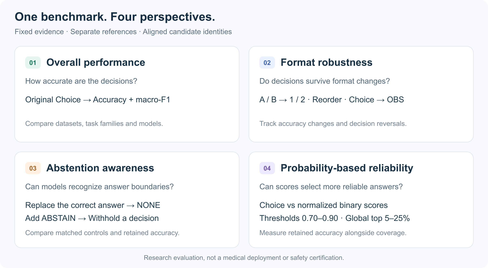

[](https://medical-decision-atlas.pages.dev/)

<p align="center">
  <strong>How Reliable Are System-One Decisions in Medicine?</strong><br>
  A Comparative Study of Jev, Jev-like Models, and LLMs
</p>

<p align="center"><strong>Last updated · October 22, 2026</strong> &nbsp; | &nbsp; First report · October 13, 2026</p>

[](https://medical-decision-atlas.pages.dev/)

<p align="center">
  <a href="https://medical-decision-atlas.pages.dev/"><strong>↗ Interactive Results Website</strong></a> &nbsp; · &nbsp;
  <a href="https://arxiv.org/abs/2610.18529">Paper on arXiv</a> &nbsp; · &nbsp;
  <a href="https://huggingface.co/datasets/yrdu/systemone-medbench"><strong>🤗 Dataset on Hugging Face</strong></a> &nbsp; · &nbsp;
  <a href="#quick-start-python-310-linux-for-gpu-inference">Quick Start</a> &nbsp; · &nbsp;
  <a href="docs/MODELS.md">Model Interfaces</a> &nbsp; · &nbsp;
  <a href="docs/PROTOCOL.md">Evaluation Protocol</a>
</p>

This repository provides **Jev-format evaluation tools for Jev and Jev-like decision models**.
The public dataset is available as **[SystemOne-MedBench on Hugging Face](https://huggingface.co/datasets/yrdu/systemone-medbench)**.
The companion study compares decision models and LLMs across medical tasks. The code here
focuses on decision-model interfaces; it does not include an LLM generation evaluator.

## Updates

**Report first released on October 13, 2026.** We continue to extend the evaluation
to newly available open-weight and closed-source decision models.

**Oct 22, 2026** · 🐘🦣 Completed evaluations of **Elephant-1 (9B)** and **Mammoth-1 (27B)**, published **[SystemOne-MedBench](https://huggingface.co/datasets/yrdu/systemone-medbench)** on Hugging Face (10 public datasets, 4,408 parent entries and 29,582 requests), and prepared the **evaluation toolkit** for release.

**Oct 20, 2026** · 🌐 Added **PPLX-Decider v1.1 / v1.2 (27B)** and the hosted **Microsoft-Decision-1** and **d1-ultra** models.

**Oct 17–18, 2026** · 📊 Extended evaluation to **StartLux v1.1 Instant (0.8B / 4B / 9B / 27B)** and **D3-mini / D3-lite / D3-nano**.

**Oct 16, 2026** · 🧩 Added **D3 (27B)** under the same four-dimensional evaluation protocol.

**Oct 15, 2026** · 🔄 Completed **Jev 1.14** evaluation alongside the original **Jev 1.13** baseline.

**Oct 13, 2026** · 📄 Released [the report](https://arxiv.org/abs/2610.18529v1), comparing Jev, representative Jev-like models, and general-purpose and medical LLMs across 15 datasets and four evaluation dimensions.

*Dates track report publication and evaluation additions, not model release dates.
The [results website](https://medical-decision-atlas.pages.dev/) provides interactive comparisons;
newly completed evaluations may appear there after a separate dashboard update.*

## Explore the results

**[Open Medical Decision Atlas →](https://medical-decision-atlas.pages.dev/)**
Compare models, inspect task-level performance, and explore robustness, abstention and
probability-based selection. The public dashboard requires no login and includes results
for both decision models and LLMs.

[](https://medical-decision-atlas.pages.dev/)

*Website snapshot, October 22, 2026. Open the interactive website for its current results
and cohort notes; this image is a preview, not a separate results table.*

**Jump to a dimension** &nbsp;
[Performance](https://medical-decision-atlas.pages.dev/#overall) ·
[Robustness](https://medical-decision-atlas.pages.dev/#robustness) ·
[Abstention](https://medical-decision-atlas.pages.dev/#abstention) ·
[Probability reliability](https://medical-decision-atlas.pages.dev/#reliability)

## Evaluation at a glance



| Dimension | Inputs | Main outputs |
|---|---|---|
| Overall performance | Original Choice | Accuracy, macro-F1, dataset/category/overall |
| Format robustness | Numeric relabeling, option reordering, option-wise binary scoring (OBS) | Accuracy change, decision reversal, within-dataset accuracy variance, TV |
| Abstention awareness | Correct-answer replacement with NONE; optional ABSTAIN | Matched original comparison, conditional NONE accuracy, abstention/retention and accuracy deltas |
| Probability-based reliability | Choice and OBS | Accuracy, retained count and coverage at thresholds and matched global coverage |

All prompts, criteria, option ordering and identity mappings are frozen. References are
stored separately and are not passed to any inference adapter. OBS uses independent native
Noul questions (or explicitly documented binary adaptations) and **linear** normalization
of affirmative probabilities. It is not a softmax applied to binary probabilities.

## What is released

**[Browse and download SystemOne-MedBench →](https://huggingface.co/datasets/yrdu/systemone-medbench)**

| Scope | Datasets | Parent entries | Evaluation requests |
|---|---:|---:|---:|
| **Full paper benchmark** | 15 | 8,742 | 65,252 |
| **Public data release** | 10 | 4,408 | 29,582 |

The four task families are **Triage and Navigation**, **Clinical Judgment**, **Safety Review**
and **Physiological Assessment**. The public release retains the paper's frozen Jev inputs,
detached reference labels and candidate mappings for the redistributable datasets.

> **Different scope, different denominator.** MIMIC-derived subsets and VitalDB-MAP are
> withheld from public redistribution. Public-subset scores are not full-paper scores.
> See [data access and source licenses](docs/DATA_ACCESS.md) for access requirements.

## Quick start (Python 3.10+; Linux for GPU inference)

Run commands from this repository directory. Download the public dataset at the pinned
release revision, then validate its files. The downloader uses `huggingface_hub`; data validation,
sharding, API evaluation and scoring use only the standard library.

```bash
pip install -r requirements.txt
python bench.py download --repo yrdu/systemone-medbench \
  --revision f704b2a1785770e5a673d9725f8fb605f2f22e01 --output data/public
python bench.py validate --data data/public/data/jev
python -m unittest discover -s tests -v
```

All examples below use `--data data/public/data/jev`. If you already have the paired local
release folders, use `--data ../huggingface/data/jev` instead. Pin an immutable dataset commit
when comparing runs; do not silently switch to a newer data revision.

### Jev / hosted decision APIs

All network execution is **opt-in**. Check a dry run first.

```bash
python bench.py api --profile jev-1.14 --data data/public/data/jev --output runs/jev-1.14
python bench.py api --profile jev-1.14 --data data/public/data/jev --output runs/jev-1.14 \
  --workers 4 --rps 2 --execute --allow-external
```

The runner asks for the key using a hidden prompt. Alternatively provide
`OPENROUTER_API_KEY` through your secret manager/environment; **never put a key in a
command-line argument, config file or committed `.env` file**. Authorization headers are
not saved. The runner blocks redirects and stops on authentication, billing or response-version
errors. Request/response files are private run artifacts, not upload artifacts.

Profiles include `jev-1.13`, `jev-1.14`, `microsoft-decision-1`, `d1-ultra`, and
`gpt6-luna-decisions`. These are historical route/version snapshots, not a promise of current
provider access. The GPT profile documents an attempted interface, not a completed benchmark.
See [model interfaces](docs/MODELS.md) before use. An existing TypeSafe direct endpoint is also
supported with `--provider typesafe --model ... --expected-response-model ...` and
`TYPESAFE_API_KEY`. Do not replace a requested model with a different model on failure.

Rerunning the **same command with the same output directory** skips verified successful
responses and retries failures; changed fingerprints are refused. `--case-limit 1` is useful
for a small API probe (use a separate output directory). Do not merge probe and full-run outputs.

### Local decision models / multi-GPU

Install model-specific dependencies in an **isolated environment**, then download the complete
checkpoint, including its configuration, tokenizer and native source files. No model weights
are included in this repository. Do not overwrite a vendor-specific PyTorch/CUDA stack.

Example for D3, one replica per GPU (data parallelism, not tensor parallelism):

```bash
python bench.py prepare --data data/public/data/jev --work runs/d3 --shards 4
python bench.py native --adapter d3 --model /path/to/d3 --response-model d3 \
  --work runs/d3 --devices 0 --pilot --execute
python bench.py native --adapter d3 --model /path/to/d3 --response-model d3 \
  --work runs/d3 --devices 0,1,2,3 --execute
```

Set `--response-model` to the **exact identifier returned by that checkpoint**, as confirmed
by its configuration and pilot. The launcher refuses occupied GPUs and never kills unrelated
processes. A pilot covers every included dataset/variant and the longest serialized input;
the 10-option numeric format is included. Full inference requires a successful pilot.
If the native worker completed the pilot with **only explicitly classified length errors**,
inspect them and use `--allow-pilot-length-errors` to acknowledge those known limits before
the full launch. This never permits OOM/inference errors or incomplete pilots; the report still
requires completeness or a separately declared `--exclude-length-errors` matched cohort.
Change `--shards` and `--devices` together for 1, 4, 8 or 16 independent GPU replicas.
The full model must fit on each GPU; no automatic quantization or multi-GPU model splitting occurs.

Supported adapters are `d3`, `startlux-v1`, `startlux-v11`, `kev`, `semif`, `anyjev`,
`gliner`, `openjev`, `pplx-v11`, `pplx-v12`, and `qev`. Adapter-specific commands,
base-model requirements and third-party source requirements are in [MODELS.md](docs/MODELS.md).

### Score the four dimensions

```bash
# Hosted API run
python bench.py report --interface jev --data data/public/data/jev \
  --run runs/jev-1.14 --name 'Jev 1.14' --output runs/jev-1.14/report
# Local model run
python bench.py report --interface native --data data/public/data/jev \
  --run runs/d3 --name 'D3 (27B)' --output runs/d3/report
```

Outputs include `audit.json`, `comparison.json`, `REPORT.md` and `case_results.jsonl`.
The default report requires complete, valid results. Missing responses, OOMs and length errors
are **not scored as incorrect**. A failed audit stops the complete-report path; inspect and
resolve failures rather than silently changing the cohort. See [metrics and exclusions](docs/PROTOCOL.md).

## Layout and safety

```text
bench.py                 Unified command entry
scripts/                 API runner, native launcher, sharding and four-dimension scorer
scripts/native/          Explicit per-family model adapters
vendor/                  Licensed, version-frozen upstream source only (no weights)
configs/                 Paper scope, dataset source information and source fingerprints
docs/                    Data access, protocols, model interfaces, release/testing notes
examples/<dataset>/      One complete public request and detached reference per released dataset
tests/                   Alignment, normalization, parsing and offline end-to-end tests
tools/                   Validation, HF download, authorized local import and release scan
```

No API credentials, patient records from credentialed sources, private execution logs,
institution-specific download commands, server addresses or local account paths should be
committed. Before publishing, run `python bench.py scan --root .` and inspect the result.
The scanner is a safeguard, not a legal or privacy certification.

This benchmark is for research, not diagnosis or deployment authorization. Source annotation
limitations, repeated evidence, category overlap and potential pretraining contamination remain.
Counts describe benchmark entries, not independent patients. Do not train on the evaluation
split and then claim held-out performance. See the separate licenses for data, model weights
and vendored code. No pretrained weights or paid API access are provided.

## Citation

If this benchmark supports your research, please cite the
[paper](https://arxiv.org/abs/2610.18529).

```bibtex
@article{du2026reliable,
  title={How Reliable Are System-One Decisions in Medicine? A Comparative Study of Jev, Jev-like Models, and LLMs},
  author={Du, Yanrui and Zhao, Danyang and Zhao, Sendong and Li, Wenhao and Gao, Yibo and Wang, Haochun and Xu, Zhuoer and Cui, Shiwen and Qin, Bing},
  journal={arXiv preprint arXiv:2610.18529},
  year={2026},
  doi={10.48550/arXiv.2610.18529}
}
```

---

**[Explore the evaluation website ↗](https://medical-decision-atlas.pages.dev/)** ·
[Read the paper](https://arxiv.org/abs/2610.18529) ·
[Dataset on Hugging Face](https://huggingface.co/datasets/yrdu/systemone-medbench) ·
[Source rights](THIRD_PARTY.md)
